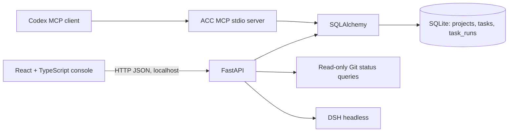

# ACC architecture

The API owns project, task, and task-run records. Existing repositories must be beneath configured trusted roots before registration. New repositories created by ACC may be placed outside those roots; the record stores that explicit choice and dispatch rechecks that the repository still exists. Git subprocesses use argument arrays and read-only status commands. The browser and API bind to loopback in the PowerShell launcher; a configured bearer token protects API routes.

## DSH and Codex integration

The installed Windows Desktop shim reports `0.2.1-rc.5`. Its local `dsh --profile headless --help` lists positional task text, `--json`, and `--session-id`; ACC constructs only those verified flags. DSH runs under the current Windows user's permissions. Its Windows ACL backend is partial: it restricts writes but does not confine reads, and documents NTFS hard-link and cross-tool ACL limitations. ACC verifies a registered project path before launch, but this is a dispatch check, not a filesystem sandbox. DSH's own configuration determines effective permissions; ACC does not override the permission mode or require a filesystem acknowledgement.

The local stdio MCP server exposes project and task queries, task creation, run dispatch, and run-history reads. It uses the same SQLite records and `execute_run` path as the API, so a task or run created from Codex is visible in ACC. DSH execution remains Headless and runs with the current Windows user's permissions. The MCP process loads only non-secret `ACC_*` settings from the workspace `.env`; the ACC API token is not copied to DSH. An optional `session_id` is passed through to the verified DSH CLI, but this does not provide desktop-session control or streaming.

References: [DSH CLI guide](https://deepseekdocs.com/en/docs/user-guide/cli), [Codex configuration](https://github.com/openai/codex/blob/main/docs/config.md).

API and MCP task runs have durable status, exit code, result, timestamps, session reference, and log path. DSH stdout/stderr are redacted before persistence. Worktrees, cancellation, streaming, desktop-session control, and human-reviewed integration remain future work.
