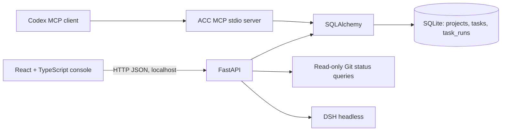

# ACC architecture

The API owns project, task, and task-run records. Existing repositories must be beneath configured trusted roots before registration. New repositories created by ACC may be placed outside those roots; the record stores that explicit choice and dispatch rechecks that the repository still exists. Git subprocesses use argument arrays and read-only status commands. The browser and API bind to loopback in the PowerShell launcher; a configured bearer token protects API routes.

## DSH and Codex integration

The installed Windows Desktop shim reports `0.2.1-rc.5`. Its local `dsh --profile headless --help` lists positional task text, `--json`, and `--session-id`; ACC constructs only those verified flags. DSH runs under the current Windows user's permissions. Its Windows ACL backend is partial: it restricts writes but does not confine reads, and documents NTFS hard-link and cross-tool ACL limitations. ACC verifies a registered project path before launch, but this is a dispatch check, not a filesystem sandbox. DSH's own configuration determines effective permissions; ACC does not override the permission mode or require a filesystem acknowledgement.

The local stdio MCP server exposes project and task queries, task creation, run dispatch, and run-history reads. Tasks now record their assigned agent and optional parent task, which lets the console render Codex-led missions with DSH child tasks. `acc_start_mission` records a running Codex root, `acc_create_task` creates linked DSH work, and `acc_finish_mission` records the integrated result only after every direct child has completed or been cancelled. DSH runs still use the same SQLite records and `execute_run` path as API-started runs. Settings discovers Codex models through the installed app-server `model/list` API. On Windows, authenticated `POST /api/agents/codex/start` revalidates the registered workspace and hands its encoded absolute directory to `codex://threads/new?path=...` using the OS protocol handler. The locally inspected desktop route selects or registers the project and prepares a draft; it does not send a message. It preserves the active app process and Codex model settings. The frontend serializes handoffs, skips superseded queued requests, and ignores stale feedback. Selecting all workspaces or restoring a selection does not launch Codex. Other platforms retain the CLI launcher with the saved model override. ACC reports an OS request separately from confirmation of loaded conversation state, and reports local `codex.exe` processes separately from its own launcher. The Windows handoff does not own the desktop app and cannot stop it. DSH profile choices are discovered from local profile `cordis.patch.yml` provider/model fields and are invoked per delegated run, defaulting to `headless`. Agent preferences are stored in `ACC_DATA_DIR/agent-settings.json`; no credentials are copied or DSH configuration files edited. The MCP process loads only non-secret `ACC_*` settings from the workspace `.env`; the ACC API token is not copied to DSH. An optional `session_id` is passed through to the verified DSH CLI, but this does not provide desktop-session control or streaming.

References: [DSH CLI guide](https://deepseekdocs.com/en/docs/user-guide/cli), [Codex configuration](https://github.com/openai/codex/blob/main/docs/config.md).

API and MCP task runs have durable status, exit code, result, timestamps, session reference, and log path. DSH stdout/stderr are redacted before persistence. Worktrees, cancellation, streaming, desktop-session control, and human-reviewed integration remain future work.
